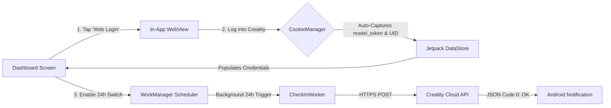

# Auto Check-In for Creality

[-3DDC84?logo=android&logoColor=white)](https://developer.android.com)
[](https://kotlinlang.org)
[](https://developer.android.com/jetpack/compose)
[](https://developer.android.com/topic/libraries/architecture/workmanager)
[](LICENSE)

A production-ready native Android application built with **Kotlin** and **Jetpack Compose (Material 3)** that automates daily check-ins on [Creality Cloud](https://www.crealitycloud.com/check-in).

> ⚠️ **Disclaimer:** This is an independent, unofficial community utility. It is **not** affiliated with, endorsed by, or sponsored by Shenzhen Creality 3D Technology Co., Ltd. or Creality Cloud. All product names, logos, and brands are property of their respective owners.

---

## 🌟 Highlights & Features

- 🔥 **Streak & Rewards Tracker**: Live dashboard showing your consecutive streak days, today's check-in status badge (`Checked In` / `Pending` / `Session Expired`), and points earned.
- ⏰ **Automated 24-Hour Background Execution**: Integrated with Android `WorkManager` and `CoroutineWorker`. Runs autonomously every 24 hours with network-connectivity constraints.
- 🌐 **In-App WebView Login (Zero-Effort Cookie Capture)**: Built-in WebView automatically extracts your `model_token` and `model_user_id` upon login, saving them directly into encrypted local storage without manual copy-pasting.
- ✏️ **Manual Credential Override**: Full visibility into your session. Inspect token status or paste raw cookie strings manually anytime.
- 📋 **Live Response Payload Inspector**: Monospace viewer displaying formatted API JSON responses with one-tap clipboard copy for troubleshooting.
- 🛡️ **Privacy by Design**: Zero cloud tracking or analytics. All tokens, cookies, and device identifiers remain exclusively on your device.

---

## 📱 User Interface & Flow



---

## 🛠️ Tech Stack & Architecture

- **UI Framework**: Modern declarative Jetpack Compose with Material 3 styling (dark theme optimized).
- **Architecture**: Single-Activity pattern (`MainActivity.kt`), Clean Architecture with `ViewModel` and `StateFlow`.
- **Networking**: `com.squareup.okhttp3:okhttp:4.12.0` with verified Creality client headers (`__cxy_*`, user agent spoofing, and dynamic request IDs).
- **Background Jobs**: `androidx.work:work-runtime-ktx:2.9.1` (`CoroutineWorker` + `PeriodicWorkRequest`).
- **Data Persistence**: `androidx.datastore:datastore-preferences:1.1.1` (excluded from OS cloud backups for credential security).
- **Minimum SDK**: Android 8.0 (API 26) • **Target SDK**: Android 14 (API 34).

---

## 🚀 Getting Started

### Prerequisites
- [Android Studio Ladybug / Meerkat](https://developer.android.com/studio) or newer
- Android SDK Platform 34
- JDK 17 or JDK 21

### 1. Clone the Repository
```bash
git clone https://github.com/abhaydasah13/Auto-check-in-for-Creality.git
cd Auto-check-in-for-Creality
```

### 2. Build the Debug APK
```bash
./gradlew assembleDebug
```
The compiled APK will be located at:
```
app/build/outputs/apk/debug/app-debug.apk
```

### 3. Install to Connected Device via ADB
```bash
adb install -r app/build/outputs/apk/debug/app-debug.apk
```

### 4. Build Signed Play Store App Bundle (`.aab`)
```bash
./gradlew bundleRelease
```
The signed `.aab` bundle will be generated at:
```
app/build/outputs/bundle/release/app-release.aab
```

### 5. Run Unit Tests
```bash
./gradlew testDebugUnitTest
```

---

## 🔒 Privacy Policy

Your privacy is paramount. This application stores all session tokens in your device's private sandbox storage and communicates directly with Creality Cloud's servers over TLS encryption. 

Read the full [Privacy Policy](PRIVACY_POLICY.md).

---

## 📄 License

This project is licensed under the MIT License - see the [LICENSE](LICENSE) file for details.
